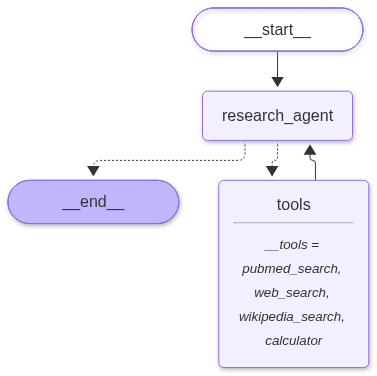

# Agentic Research Assistant with LangGraph

A multi-tool scientific research assistant built using **LangChain, LangGraph and OpenAI**. The assistant dynamically selects research tools, retrieves scientific evidence, performs mathematical calculations and maintains conversational context across multiple interactions.

## Features

- **PubMed Search:** Retrieve biomedical research publications, abstracts and source links using NCBI E-utilities.
- **Web Search:** Retrieve current information using Tavily.
- **Wikipedia Search:** Find background information and explanations of scientific concepts.
- **Calculator:** Evaluate mathematical expressions using a restricted Python Abstract Syntax Tree (AST).
- **Dynamic Tool Selection:** Allow the language model to select appropriate tools based on the research question.
- **Multi-tool Reasoning:** Combine scientific retrieval and numerical calculations within a single workflow.
- **Conversation Memory:** Maintain conversation history using LangGraph's `MemorySaver`.
- **Execution Streaming:** Inspect agent and tool execution using LangGraph's streaming interface.

## Architecture

The research assistant uses a LangGraph `StateGraph` with a research agent node, a tool execution node and conditional routing.



**Workflow:**

1. The user submits a research question.
2. The language model determines whether external tools are required.
3. LangGraph routes tool requests to `ToolNode`.
4. Tool results return to the research agent for interpretation.
5. The agent can request additional tools or produce its final response.
6. `MemorySaver` maintains conversation state using a `thread_id`.

## Technology Stack

| Component | Technology |
|---|---|
| Programming language | Python 3.11 |
| LLM | OpenAI GPT-4o mini |
| Agent framework | LangGraph |
| LLM integration | LangChain |
| Biomedical literature | PubMed via Biopython |
| Web search | Tavily |
| General knowledge | Wikipedia |
| Mathematical calculations | Python AST |
| Conversation memory | LangGraph MemorySaver |
| Testing | pytest |
| Development environment | VS Code, Conda, Jupyter |

## Project Structure

```text
Agentic-Research-Assistant-LangGraph/
├── src/
│   ├── __init__.py
│   ├── agent.py
│   ├── config.py
│   └── tools/
│       ├── __init__.py
│       ├── pubmed_search.py
│       ├── web_search.py
│       ├── wikipedia_search.py
│       └── math_tools.py
├── notebooks/
│   └── 01_agentic_research_demo.ipynb
├── tests/
│   ├── test_agent_integration.py
│   └── test_math_tools.py
├── results/
│   └── langgraph_architecture.png
├── .env
├── .gitignore
├── README.md
└── requirements.txt
```

*The `.env` file is local and must not be committed to Git.*

## Installation

Clone the repository and navigate to the project directory.

```bash
git clone https://github.com/YOUR_USERNAME/Agentic-Research-Assistant-LangGraph.git
cd Agentic-Research-Assistant-LangGraph
```

Create and activate a Conda environment:

```bash
conda create -n langchain-ai python=3.11 -y
conda activate langchain-ai
```

Install dependencies:

```bash
python -m pip install -r requirements.txt
```

## Environment Configuration

Create a `.env` file in the project root:

```dotenv
OPENAI_API_KEY=your_openai_api_key
TAVILY_API_KEY=your_tavily_api_key
NCBI_EMAIL=your_email@example.com
```

An OpenAI API key and Tavily API key are required. PubMed access uses NCBI's public E-utilities API, which does not require an API key for basic use.

**Security:** Never commit your `.env` file or expose API credentials in notebooks, logs or GitHub.

## Running the Research Assistant

The interactive demonstration is available in:

`notebooks/01_agentic_research_demo.ipynb`

Open the notebook in VS Code, select the Python environment containing the project dependencies and run its cells sequentially.

The notebook demonstrates:

1. Agent initialisation and tool registration.
2. PubMed scientific literature search.
3. Dynamic selection between web and Wikipedia tools.
4. Multi-tool research and mathematical calculations.
5. Conversation memory across follow-up questions.
6. Node-level execution streaming.
7. LangGraph architecture visualisation.

## Example Research Workflow

**Research question:**

> Find a published study comparing deep learning and radiologists for prostate cancer detection using MRI. Calculate the difference between their external-test AUC values.

**Example tool execution:**

```text
research_agent
    ↓
pubmed_search
    ↓
research_agent
    ↓
calculator
    ↓
research_agent
    ↓
Final response
```

**Example result:**

The 2024 study *Fully Automated Deep Learning Model to Detect Clinically Significant Prostate Cancer at MRI* reported external-test AUC values of:

| Method | AUC |
|---|---:|
| Deep learning model | 0.86 |
| Radiologists | 0.84 |
| Difference | 0.02 |

The AUC difference is **0.02, equivalent to 2 percentage points**.

Source: [PubMed PMID 39105640](https://pubmed.ncbi.nlm.nih.gov/39105640/)

These values are from the specified study and should not be interpreted as evidence that deep learning systems generally outperform radiologists.

## Running Tests

The project includes local calculator unit tests and an end-to-end agent integration test.

Run calculator unit tests without external API calls:

```bash
python -m pytest tests/test_math_tools.py -v
```

Run the live agent integration test:

```bash
python -m pytest tests/test_agent_integration.py -v -s
```

Run the complete test suite:

```bash
python -m pytest tests/ -v
```

**Note:** The integration test requires access to OpenAI and PubMed, may incur API charges and can vary because language model tool selection is probabilistic.

## Current Limitations

- Conversation memory is held in-process and is lost when the application restarts.
- Scientific evidence is retrieved primarily from PubMed metadata and abstracts, rather than verified full-text publications.
- The assistant may occasionally select an inappropriate tool or generate an inaccurate summary.
- Citation URLs are included in responses, but automated citation verification is not yet implemented.
- The mathematical calculator supports a restricted set of operations with basic resource limits.
- The project is a research and educational demonstration, not a clinical decision-support system.

## Future Development

Planned extensions include:

- **Retrieval-Augmented Generation (RAG):** Upload and query research documents using embeddings and vector search.
- Persistent conversation memory using database-backed checkpointing.
- Improved source verification and citation handling.
- More comprehensive automated tests and agent evaluation.
- Better error handling, logging and observability.
- A user-facing research interface.

## Project Purpose

This project was developed as a practical exploration of **agentic AI engineering**, demonstrating how large language models can orchestrate external tools, maintain conversation state and execute multi-step research workflows using LangGraph.

It also serves as a foundation for future document-grounded scientific research applications.